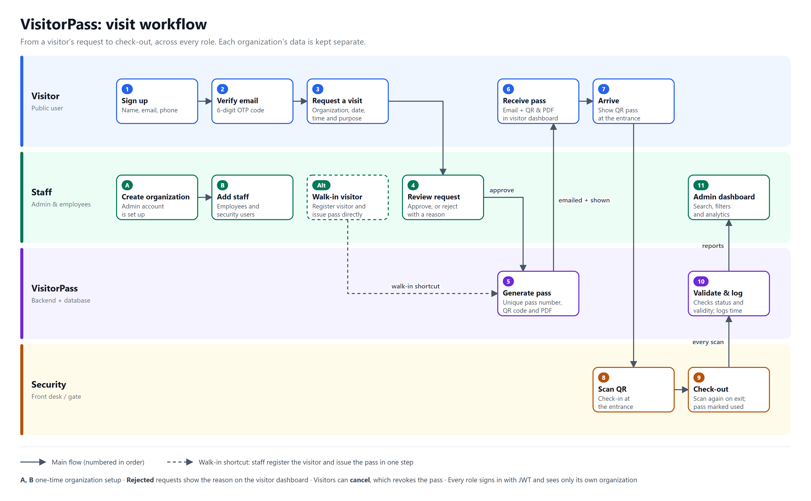

# Visitor Pass Management System (VPM)

A MERN application for managing visitor registration, appointments, digital passes, and secure check-in/check-out. This repository follows the assignment's core entities: Users, Visitors, Appointments, Passes, and CheckLogs.



## Roles and workflow

- **Admin:** manages user accounts and views system information.
- **Employee/Host:** registers a visitor and appointment in one submission. The logged-in employee is assigned as host. The employee workflow can approve the appointment and issue a pass to reduce visitor waiting time.
- **Security/Frontdesk:** views issued passes and records check-in/check-out. Security users can also access the combined issuance workflow.
- **Visitor:** self-registers (email verified with a one-time code), requests appointments with any active organization, tracks their status, and shows the QR pass or downloads the PDF from the visitor dashboard. Also receives the pass by email when SMTP is configured.

The combined endpoint creates/reuses the visitor, creates an approved appointment, generates a unique pass and QR code, and attempts email delivery. Email failures are recorded separately so they do not discard the created pass.

## Stack

- Frontend: React, React Router, Axios, Tailwind CSS (Create React App)
- Backend: Node.js, Express, Mongoose
- Database: MongoDB
- Authentication: JWT and bcrypt password hashing
- Passes: `qrcode` for QR data URLs and `pdfkit` for PDF output
- Email: Nodemailer over configured SMTP

## Project structure

```text
visitor-pass-management-system/
├── backend/
│   ├── controllers/
│   ├── middleware/        # JWT authentication and role checks
│   ├── models/
│   ├── routes/
│   ├── scripts/           # initial admin seed
│   ├── services/          # PDF and email services
│   ├── server.js
│   └── databaseConnection.js
└── frontend/
    └── src/
        ├── components/
        ├── pages/
        └── services/api.js
```

## Setup

### 1. Requirements

Install Node.js and npm, and have access to a MongoDB database (local or Atlas).

### 2. Backend configuration

```bash
cd backend
npm install
```

Copy `.env.example` to `.env` and set `URL`, a strong `JWT_SECRET`, admin seed values, and SMTP values. Do not commit `.env`.

Create the first admin user:

```bash
npm run seed:admin
```

Start the backend:

```bash
npm run dev
```

The API defaults to `http://localhost:4000`. Health check: `GET http://localhost:4000/api/health`.

### 3. Frontend

In another terminal:

```bash
cd frontend
npm install
npm start
```

The React app defaults to `http://localhost:3000`. To use a deployed/different backend, define `REACT_APP_API_URL` in the frontend environment without the `/api` suffix, for example `REACT_APP_API_URL=http://localhost:4000`.

## Visitor self-service and OTP verification

1. The visitor signs up at `/visitor/register` (name, email, phone, password). The account is created unverified and a 6-digit code is emailed.
2. The visitor enters the code at `/visitor/verify-otp`. Codes expire after 10 minutes, allow 5 attempts, are stored only as a SHA-256 hash, and can be resent after 60 seconds.
3. Logging in with an unverified account returns `403` with `code: "EMAIL_NOT_VERIFIED"`; the UI sends the visitor back to the verification page.
4. Once verified, the visitor books appointments at `/visitor/appointments`. Staff approve them on the Appointments page, which issues a pass and emails it. The visitor can then view the QR code, download the PDF, or cancel (cancelling revokes the pass).

When SMTP is not configured and `NODE_ENV` is not `production`, OTP codes are printed to the backend console so the flow can be tested locally.

## Search, filters and analytics

- The Visitors, Appointments, Passes and Check Logs pages have a search box plus status/action and date-range filters. The backend handles filtering through query parameters such as `?search=&status=&from=YYYY-MM-DD&to=YYYY-MM-DD`.
- The admin dashboard shows an analytics section for the last 7, 30 or 90 days: check-ins per day, busiest hours, appointments by status, top hosts, unique visitors, approval rate and average visit length. Daily data is also available as a table.

## Docker deployment (Nginx)

The repository ships with a production setup: MongoDB (single-node replica set, which organization registration needs for transactions), the Express API, and the React build served by Nginx. Nginx also proxies `/api` to the backend and rate-limits `/api/auth`.

```bash
cp backend/.env.example backend/.env   # set JWT_SECRET, SMTP_*, ...
docker compose up -d --build
```

Open `http://localhost`. Optional variables: `HTTP_PORT` (default `80`) and `PUBLIC_URL` (the public origin, used for CORS). The `URL`, `PORT`, `NODE_ENV` and `FRONTEND_URL` values from `backend/.env` are overridden in `docker-compose.yml`, so the API always uses the bundled MongoDB. Data persists in the `mongo-data` volume. To try OTP without SMTP inside Docker, set `LOG_OTP_CODES=true` in `backend/.env` and read the code with `docker compose logs backend`.

## Main API endpoints

All endpoints except login and health require `Authorization: Bearer <JWT>` unless stated otherwise. Role permissions are enforced by backend middleware.

| Method | Endpoint | Purpose | Access |
|---|---|---|---|
| POST | `/api/auth/login` | Login and receive JWT | Public |
| GET | `/api/auth/me` | Current user | Authenticated |
| POST | `/api/auth/visitor/register` | Start visitor registration and email an OTP | Public |
| POST | `/api/auth/visitor/verify-otp` | Verify `{ email, otp }` and receive a JWT | Public |
| POST | `/api/auth/visitor/resend-otp` | Send a new OTP (60 s cooldown) | Public |
| GET | `/api/organizations/public` | Active organizations visitors can book with | Public |
| POST | `/api/appointments/visitor` | Request an appointment | Visitor |
| GET | `/api/appointments/my-appointments` | Own appointments with issued pass | Visitor |
| PATCH | `/api/appointments/my-appointments/:id/cancel` | Cancel own appointment (revokes pass) | Visitor |
| GET | `/api/appointments/my-appointments/:id/pass-pdf` | Download own pass PDF | Visitor |
| GET | `/api/appointments/pending-visitors` | Pending appointment requests | Admin, Employee |
| PATCH | `/api/visits/appointments/:id/approve` | Approve request and issue pass | Admin, Employee |
| PATCH | `/api/visits/appointments/:id/reject` | Reject request with `rejectionReason` | Admin, Employee |
| POST | `/api/users` | Create user | Admin |
| GET | `/api/users` | List users | Admin |
| GET/PUT/DELETE | `/api/users/:id` | Read/update/delete user | Admin |
| POST | `/api/visits/register-and-issue` | Register visitor + appointment + pass; attempt email delivery | Admin, Employee, Security |
| GET | `/api/visitors` | List visitors | Admin, Employee, Security |
| GET | `/api/appointments` | List appointments | Admin, Employee, Security |
| PUT | `/api/appointments/:id/status` | Update appointment status | Authenticated roles with appointment access |
| GET | `/api/passes` | List passes | Admin, Employee, Security |
| GET | `/api/passes/:id/pdf` | Download a pass PDF by pass ID or pass number | Admin, Employee, Security |
| PUT | `/api/passes/:id/status` | Update pass status | Admin, Security |
| POST | `/api/check-logs` | Record validated check-in/check-out | Admin, Security |
| GET | `/api/check-logs` | List check logs | Admin, Security |
| GET | `/api/dashboard/stats` | Live database counts | Admin, Employee, Security |
| GET | `/api/dashboard/analytics?days=30&tz=Asia/Kolkata` | Analytics for 7/30/90 days | Admin |

The list endpoints `/api/visitors`, `/api/appointments`, `/api/passes` and `/api/check-logs` accept `search`, `from` and `to`; appointments and passes also accept `status`, and check logs accept `action`.

### Combined registration request

`POST /api/visits/register-and-issue`

```json
{
  "visitor": {
    "name": "John Kumar",
    "email": "john@example.com",
    "phone": "9876543210",
    "photo": ""
  },
  "appointment": {
    "purpose": "Project discussion",
    "appointmentDate": "2026-10-15",
    "appointmentTime": "10:30"
  }
}
```

The backend takes the host identity from the verified JWT, not from a user-supplied host ID. `emailStatus` indicates whether delivery was sent, failed, not configured, or skipped because no visitor email was provided.

## Email configuration

Email is only sent when `SMTP_HOST`, `SMTP_PORT`, `SMTP_USER`, `SMTP_PASS`, and `MAIL_FROM` are configured. Use credentials from your email provider; never put credentials in source code or commit them. Without SMTP configuration, pass creation still succeeds and the API returns an email status explaining why delivery was skipped.

## Important implementation notes

- The first administrator is created through the seed script; public registration is not exposed.
- Passwords are hashed using bcrypt and are not returned in user API responses.
- The QR code encodes a pass number and appointment ID. The backend must still validate pass status and validity before recording check-in/out; do not trust the QR payload alone.
- PDF passes are generated on demand and emailed as attachments. No generated PDF files are stored on the server filesystem.
- Visitor photo is currently accepted as a URL/string; actual multipart photo upload/storage remains a future improvement.
- The current UI records check-in/check-out through the API workflow; a camera-based QR scanner UI, SMS integration, exports, and automated email retry queue remain future improvements.
- The check-in/check-out API is `POST /api/check-logs` with `{ "pass": "<pass MongoDB ID>", "action": "check-in" }` or `action: "check-out"`.

## Suggested test sequence

1. Configure `.env`, install backend dependencies, and run `npm run seed:admin`.
2. Start backend and frontend.
3. Log in with the seeded admin credentials.
4. Create an Employee user from the Users page.
5. Log in as that employee and submit the combined visitor/appointment form.
6. Check the pass number, QR code, PDF download, and returned email status.
7. Log in as Security to test check-in and check-out through the check-log API.

## Future improvements

- Camera-based QR scanner page and pass validation UX.
- Actual visitor photo upload to object storage.
- Background queue and retry policy for email delivery.
- SMS notifications, report export, and audit trails.
- Automated tests for role permissions and the end-to-end issuance workflow.
